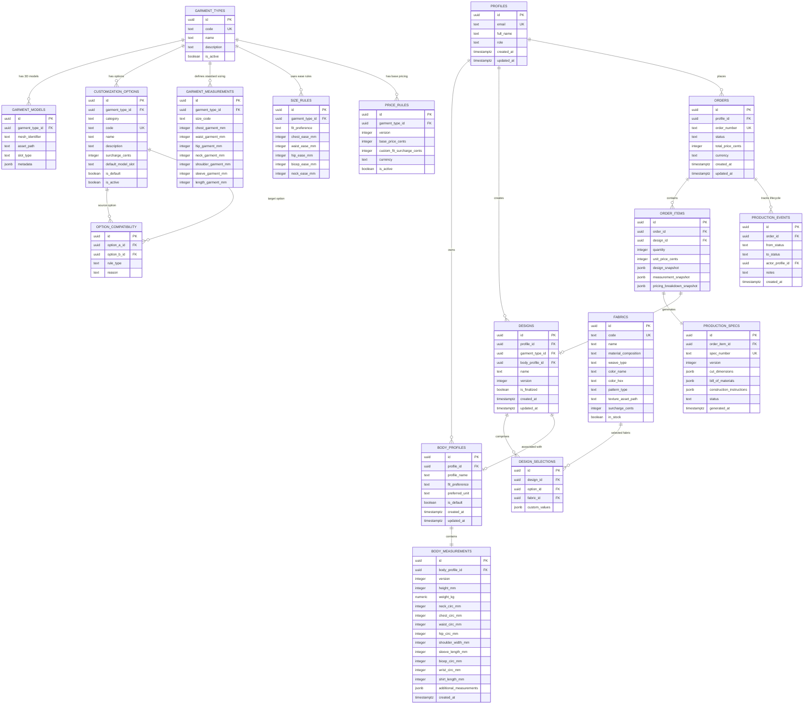
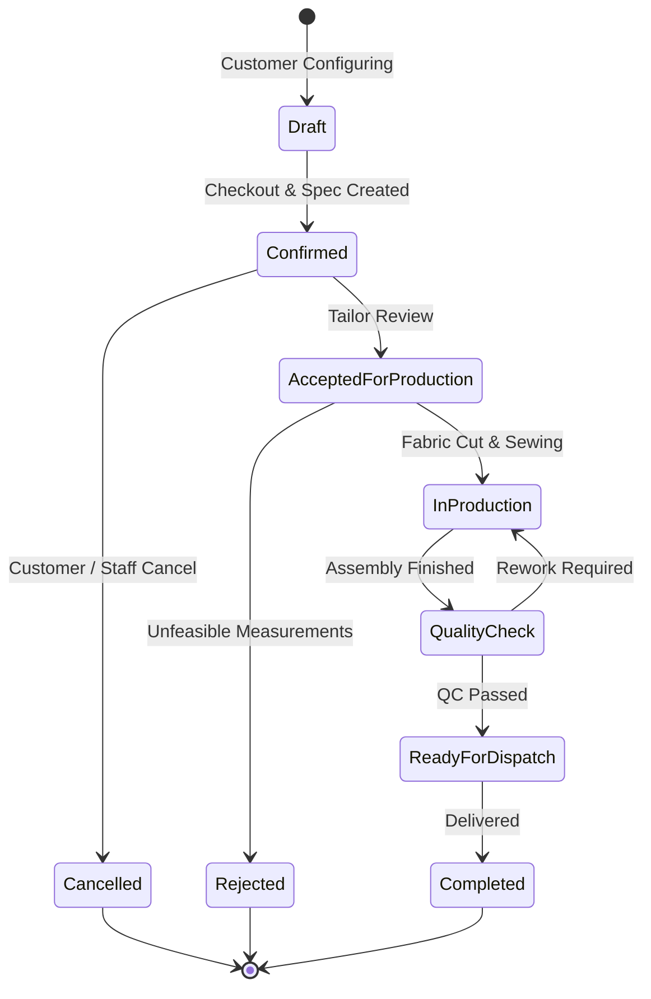

# Custom Clothing Platform — Architecture & V1 Implementation Plan

## 1. System Architecture Overview

The Custom Clothing Platform V1 MVP is architected as a modular, offline-first, client-and-backend application designed for functional correctness, data integrity, and zero-cost development.

### 1.1 Architectural Pillars
1. **Headless Domain Logic**: The Core Business Engines (`measurements`, `customization`, `sizing`, `pricing`, `orders`) are completely decoupled from UI components and 3D rendering. They are pure TypeScript modules with zero DOM or Three.js dependencies, enabling comprehensive unit testing in Vitest and reusability on server/edge environments.
2. **Dual-Mode Persistence (Offline-First / Zero-Cost)**:
   - **Local Development Mode**: An in-memory and `localStorage`-backed repository layer implements the exact same TypeScript data contracts as Supabase. This guarantees that developers can run, test, and demonstrate the entire platform offline without cloud dependencies, API keys, or paid subscriptions.
   - **Supabase Cloud Mode**: Uses Supabase Auth and PostgreSQL with Row Level Security (RLS) when configured via environment variables (`VITE_SUPABASE_URL`, `VITE_SUPABASE_ANON_KEY`).
3. **Decoupled 3D Presentation Layer**: The 3D Avatar and Garment visualization is purely a visual projection of the validated `DesignState` and `BodyMeasurements`. Business rules, compatibility constraints, and price computations are never derived from 3D scene state.
4. **Immutable Order & Production Specifications**: Orders take an immutable snapshot of designs, measurements, tailoring allowances, and pricing rules at checkout. Subsequent changes to catalog prices or customer profiles never alter historical order records.

```mermaid
graph TD
    subgraph Presentation ["Presentation Layer (React + Three.js)"]
        UI[Customizer UI & Form Components]
        Canvas3D[R3F 3D Canvas]
        AvatarView[3D Avatar Renderer]
        GarmentView[3D Garment Mesh & Material View]
        Canvas3D --> AvatarView
        Canvas3D --> GarmentView
    end

    subgraph CoreEngines ["Headless Core Engines (Pure TypeScript + Zod)"]
        AuthMod[Auth & Profile Module]
        MeasMod[Body Measurement Engine]
        CustMod[Customization & Compatibility Engine]
        SizeMod[Size & Fit Engine]
        PriceMod[Server-Authoritative Pricing Engine]
        OrderMod[Order & Production Spec Engine]
    end

    subgraph DataAbstraction ["Data Access Layer"]
        RepoInterface[Data Repositories Interface]
        LocalRepo[Local Dev Adapter (LocalStorage)]
        SupaRepo[Supabase Client Adapter]
        RepoInterface --> LocalRepo
        RepoInterface --> SupaRepo
    end

    subgraph Backend ["Persistence (PostgreSQL / Supabase)"]
        PG[(PostgreSQL Schema + RLS)]
        AuthService[Supabase Auth]
    end

    UI --> CoreEngines
    GarmentView -.->|Observes Validated State| CustMod
    AvatarView -.->|Observes Validated Measurements| MeasMod
    CoreEngines --> RepoInterface
    SupaRepo --> PG
    SupaRepo --> AuthService
```

---

## 2. Entity-Relationship Diagram (ERD)

The relational schema consists of 17 normalized tables enforcing referential integrity, check constraints, and immutable snapshots.



---

## 3. Database Schema & Migration Strategy

### 3.1 Migration File Organization
```
supabase/
  migrations/
    20261011000001_initial_core_schema.sql       -- Extensions, enums, profiles, measurements
    20261011000002_garments_and_customization.sql -- Garment types, models, fabrics, options, compatibility
    20261011000003_sizing_and_pricing.sql        -- Garment measurements, ease rules, price rules
    20261011000004_orders_and_production.sql     -- Designs, orders, specs, lifecycle events
    20261011000005_row_level_security.sql        -- Strict RLS policies and indexes
    20261011000006_order_transaction_function.sql -- PostgreSQL ACID checkout transaction
  seed.sql                                       -- Complete sample catalog, sample profiles, compatibility rules
```

### 3.2 Key Data Types & Constraints
- **Units**: All linear dimensions are stored as `INTEGER` in **millimetres (mm)** to avoid floating-point inaccuracies. Weight is stored as `NUMERIC(5,2)` in **kilograms (kg)**.
- **Monetary Values**: Stored as `INTEGER` in **minor currency units (cents/paise)**. Floating point currency storage is strictly prohibited.
- **Statuses & Enums**: Enums defined for:
  - `fit_preference_type`: `'slim'`, `'regular'`, `'relaxed'`
  - `measurement_unit`: `'metric'`, `'imperial'`
  - `compatibility_rule_type`: `'incompatible'`, `'requires'`, `'forces_default'`
  - `order_status`: `'draft'`, `'confirmed'`, `'accepted_production'`, `'in_production'`, `'quality_check'`, `'ready_dispatch'`, `'completed'`, `'cancelled'`, `'rejected'`
  - `user_role`: `'customer'`, `'staff'`, `'admin'`

### 3.3 Row Level Security (RLS) Strategy
- **Customer Isolation**: `profiles`, `body_profiles`, `body_measurements`, `designs`, and `orders` enforce `auth.uid() = profile_id`. Customers cannot read or modify any other customer's measurements or designs.
- **Public Read / Staff Write**: `garment_types`, `fabrics`, `customization_options`, `garment_measurements`, and `price_rules` are publicly readable by authenticated/anon users, but write operations are restricted to `user_role = 'staff' | 'admin'`.
- **Sensitive Isolation**: `production_specs` and `production_events` can only be queried by the specific customer who owns the parent order or by staff members. Customer contact details are not included inside `production_specs`.

---

## 4. Typed Contracts Between Modules

The interfaces are built with **TypeScript** and validated at system boundaries with **Zod**.

### 4.1 Measurement Engine Contracts (`src/modules/measurements/types.ts`)
```typescript
import { z } from 'zod';

export type FitPreference = 'slim' | 'regular' | 'relaxed';
export type DisplayUnit = 'metric' | 'imperial';

// Internal canonical representation: strictly millimetres and kilograms
export const BodyMeasurementsSchema = z.object({
  height_mm: z.number().int().min(1200).max(2300),          // 120cm - 230cm
  weight_kg: z.number().min(35).max(250),                    // 35kg - 250kg
  neck_circ_mm: z.number().int().min(300).max(600),         // 30cm - 60cm
  chest_circ_mm: z.number().int().min(700).max(1800),       // 70cm - 180cm
  waist_circ_mm: z.number().int().min(550).max(1800),       // 55cm - 180cm
  hip_circ_mm: z.number().int().min(700).max(1800),         // 70cm - 180cm
  shoulder_width_mm: z.number().int().min(350).max(650),    // 35cm - 65cm
  sleeve_length_mm: z.number().int().min(450).max(950),     // 45cm - 95cm
  bicep_circ_mm: z.number().int().min(200).max(600),        // 20cm - 60cm
  wrist_circ_mm: z.number().int().min(120).max(300),        // 12cm - 30cm
  shirt_length_mm: z.number().int().min(550).max(1050),     // 55cm - 105cm
  additional: z.record(z.string(), z.number()).optional()
});

export type BodyMeasurements = z.infer<typeof BodyMeasurementsSchema>;

export interface ConsistencyCheckWarning {
  field: keyof BodyMeasurements;
  relatedField: keyof BodyMeasurements;
  message: string;
  severity: 'warning' | 'error';
}
```

### 4.2 Customization Engine Contracts (`src/modules/customization/types.ts`)
```typescript
export type OptionCategory =
  | 'collar'
  | 'cuff'
  | 'sleeve'
  | 'placket'
  | 'pocket'
  | 'back_pleat'
  | 'hem';

export interface CustomizationOption {
  id: string;
  category: OptionCategory;
  code: string;
  name: string;
  description: string;
  surchargeCents: number;
  meshSlot: string; // Identifier for 3D model component
  isDefault: boolean;
}

export interface CompatibilityRule {
  id: string;
  sourceOptionId: string;
  targetOptionId: string;
  ruleType: 'incompatible' | 'requires' | 'forces_default';
  reason: string;
}

export interface DesignSelectionState {
  garmentTypeId: string;
  fabricId: string;
  selections: Record<OptionCategory, string>; // category -> optionId
  version: number;
}

export interface CustomizationValidationResult {
  isValid: boolean;
  errors: Array<{
    category: OptionCategory;
    optionId: string;
    message: string;
    conflictWithOptionId?: string;
  }>;
}
```

### 4.3 Sizing and Ease Engine Contracts (`src/modules/sizing/types.ts`)
```typescript
export type StandardSizeCode = 'XS' | 'S' | 'M' | 'L' | 'XL' | 'XXL' | 'CUSTOM';

export interface GarmentEase {
  chestEaseMm: number;
  waistEaseMm: number;
  hipEaseMm: number;
  bicepEaseMm: number;
  neckEaseMm: number;
}

export interface FinishedGarmentMeasurements {
  chestMm: number;
  waistMm: number;
  hipMm: number;
  neckMm: number;
  shoulderWidthMm: number;
  sleeveLengthMm: number;
  shirtLengthMm: number;
  bicepMm: number;
  wristMm: number;
}

export interface SizeRecommendation {
  recommendedSize: StandardSizeCode;
  fitPreference: FitPreference;
  targetMeasurements: FinishedGarmentMeasurements;
  standardSizeDiffs?: Record<StandardSizeCode, Record<string, number>>;
  isReliable: boolean;
  warnings: string[];
}
```

### 4.4 Pricing Engine Contracts (`src/modules/pricing/types.ts`)
```typescript
export interface PriceLineItem {
  code: string;
  description: string;
  amountCents: number;
  type: 'base' | 'fabric_surcharge' | 'customization' | 'custom_fit';
}

export interface PriceBreakdown {
  basePriceCents: number;
  fabricSurchargeCents: number;
  customizationSurchargeCents: number;
  customFitSurchargeCents: number;
  subtotalCents: number;
  taxCents: number;
  totalCents: number;
  currency: string;
  lineItems: PriceLineItem[];
  appliedRuleVersion: number;
}
```

### 4.5 Production Specification Contracts (`src/modules/production/types.ts`)
```typescript
export interface ProductionSpec {
  specNumber: string;
  orderNumber: string;
  orderItemId: string;
  garmentType: string;
  customerRef: string; // Pseudonymized reference
  version: number;
  bodyMeasurements: BodyMeasurements;
  finishedGarmentMeasurements: FinishedGarmentMeasurements;
  size: StandardSizeCode;
  fitPreference: FitPreference;
  fabric: {
    code: string;
    name: string;
    composition: string;
    color: string;
    pattern: string;
  };
  designOptions: Array<{
    category: OptionCategory;
    code: string;
    name: string;
  }>;
  quantity: number;
  tailoringNotes: string[];
  unit: 'mm';
  generatedAt: string;
}
```

---

## 5. Customization Compatibility Strategy

### 5.1 Declarative Compatibility Graph
Compatibility rules are defined as directed relationships:
- **`incompatible`**: Selecting Option A prevents Option B. (e.g., *French Cuff* is incompatible with *Short Sleeve*).
- **`requires`**: Selecting Option A demands Option B or a subset of choices. (e.g., *Tuxedo Wing Collar* requires *French Cuffs*).
- **`forces_default`**: Selecting Option A automatically resets or selects a compatible option in Category X.

### 5.2 Conflict Resolution Algorithm
1. When a user requests a change `setOption(category, optionId)`:
2. The engine executes a dry-run update on the tentative state.
3. It evaluates all active rules in topological order.
4. If a hard incompatibility exists:
   - If an automated auto-resolution rule exists (e.g. switching sleeve to 'short' automatically switches cuffs to 'none'), the engine applies the transition and informs the user with a notification.
   - If ambiguous, the engine refuses the invalid state, leaves the current state untouched, and returns a structured validation error explaining why the combination is disallowed.
5. All validations are deterministic and can be executed synchronously in memory without network latency.

---

## 6. 3D Avatar and Garment Asset Strategy

### 6.1 Avatar Strategy (Free, Legal & Realistic Scope)
- **Legal Asset**: Use an open-source, CC0 or permissive MIT low-poly human male mannequin asset in glTF/GLB format stored locally in `/public/assets/avatars/mannequin_male.glb`.
- **Morphing Limitations & Honest Representation**:
  - Full parametric mesh deformation based on 11 measurement inputs requires complex blendshapes or rigged vertex skinning that cannot be certified as an exact tailor body scan in V1.
  - **V1 Implementation**: The avatar applies proportional bone and transform scaling along anatomical axes (overall height `Y`, chest/shoulder `X/Z`, waist `X/Z`, arm length `Y`) to reflect relative proportions visually.
  - **Prominent Disclosure**: The UI will explicitly display: *"Notice: The 3D avatar provides a general visual preview of garment styling and proportions. It is not an exact photogrammetric body scan."*
- **Decoupled Architecture**: Avatar logic resides in `src/modules/avatar/AvatarViewer.tsx`. It takes `BodyMeasurements` as input props and contains zero shirt rendering logic.

### 6.2 Garment Mesh & Material Strategy
- **Modular Geometry**: The shirt model is structured into interchangeable or togglable node groups:
  - `BodyMesh` (Standard torso, placket)
  - `CollarSlots`: `collar_spread`, `collar_buttondown`, `collar_band`
  - `CuffSlots`: `cuff_barrel`, `cuff_french`, `cuff_none` (for short sleeves)
  - `SleeveSlots`: `sleeve_long`, `sleeve_short`
  - `PocketSlots`: `pocket_single_chest`, `pocket_none`
- **Fabric Simulation Policy**: Physically accurate cloth draping and real-time collision dynamics are computationally prohibitive and out of scope for V1.
- **Visual Realism via Textures**: Fabric representation uses Three.js PBR materials (`MeshStandardMaterial`):
  - Procedural / High-resolution local CC0 texture maps (Albedo, Normal, Roughness) representing:
    1. Crisp White Cotton Poplin
    2. Oxford Sky Blue
    3. Classic Navy Pinpoint
    4. Royal Blue Gingham / Checked
- **Camera Controls**: OrbitControls with preset hotkeys:
  - Front View (`[0, 0, 2.5]`)
  - Side View (`[2.5, 0, 0]`)
  - Back View (`[0, 0, -2.5]`)
  - Reset Camera

---

## 7. Sizing and Pricing Rule Design

### 7.1 Sizing and Fit Engine Calculations
1. **Target Finished Measurements**:
   $$\text{Target Chest} = \text{Body Chest} + \text{Chest Ease}(\text{Fit})$$
   $$\text{Target Waist} = \text{Body Waist} + \text{Waist Ease}(\text{Fit})$$
   $$\text{Target Hip} = \text{Body Hip} + \text{Hip Ease}(\text{Fit})$$
   $$\text{Target Neck} = \text{Body Neck} + 15\text{ mm (standard movement allowance)}$$

2. **Garment Ease Matrix (Men's Shirt)**:
   | Fit Preference | Chest Ease | Waist Ease | Hip Ease | Bicep Ease |
   | :--- | :--- | :--- | :--- | :--- |
   | **Slim Fit** | $+80\text{ mm}$ ($~3.1"$) | $+60\text{ mm}$ ($~2.4"$) | $+60\text{ mm}$ ($~2.4"$) | $+40\text{ mm}$ |
   | **Regular Fit**| $+120\text{ mm}$ ($~4.7"$) | $+100\text{ mm}$ ($~3.9"$) | $+100\text{ mm}$ ($~3.9"$)| $+60\text{ mm}$ |
   | **Relaxed Fit**| $+160\text{ mm}$ ($~6.3"$) | $+150\text{ mm}$ ($~5.9"$) | $+140\text{ mm}$ ($~5.5"$)| $+80\text{ mm}$ |

3. **Standard Size Recommendation**:
   - Calculates the Euclidean distance / variance between the customer's Target Finished Measurements and the standard grading chart (XS through XXL).
   - If deviation in chest or waist exceeds $\pm 40\text{ mm}$, the engine flags: *"Your measurements diverge from standard off-the-rack sizing. Custom Made-To-Measure tailoring is recommended."*

### 7.2 Server-Authoritative Pricing Rules
- Formula:
  $$\text{Total Cents} = (\text{BasePrice} + \text{FabricSurcharge} + \sum \text{OptionSurcharges} + \text{CustomFitSurcharge}) \times \text{Quantity}$$
- **Verification Rule**: The checkout transaction recalculates all surcharges independently using the active `price_rules` and `customization_options` tables in PostgreSQL. If the frontend-provided estimated total differs by even $1\text{ cent}$, the transaction rejects the submission to prevent client tampering.

---

## 8. Order Transaction and Production Workflow

### 8.1 Checkout Transaction Pipeline
Executed via a PostgreSQL ACID function or transaction script:
1. **Authorization**: Verify session profile owns the design.
2. **Design Integrity**: Validate all required categories (collar, cuff, sleeve, fabric, fit) are selected and compatible.
3. **Measurement Integrity**: Validate all 11 required measurements are present and within valid physical bounds.
4. **Authoritative Price Calculation**: Compute exact total in integer cents.
5. **Idempotency Protection**: Check for existing active draft or identical client mutation token.
6. **Order & Snapshot Insertion**:
   - Insert into `orders` (Status: `confirmed`).
   - Insert into `order_items` with frozen JSON snapshots: `design_snapshot`, `measurement_snapshot`, `pricing_breakdown_snapshot`.
7. **Production Spec Generation**: Insert into `production_specs` with calculated cutting dimensions, seam allowances, and tailoring instructions.
8. **Audit Trail**: Record initial entry in `production_events` (`to_status: 'confirmed'`).

### 8.2 Order Lifecycle State Machine


---

## 9. Security and Free-Tier Constraints

1. **Zero-Cost Operation**:
   - 100% runnable in local development mode without network calls or cloud credentials.
   - Seed data scripts provide instant pre-populated catalogs, fabrics, and test customer profiles.
2. **Supabase Free Quota Management**:
   - Stays well within the 500MB database limit by storing 3D model assets and textures in the local Vite `public/` directory rather than Supabase Storage buckets.
   - Minimizes database roundtrips by compiling client-side validations via Zod identical to the database constraints.
3. **Credential Security**:
   - Only `VITE_SUPABASE_ANON_KEY` is referenced in the frontend.
   - `SERVICE_ROLE_KEY` is strictly prohibited in frontend bundles.
   - `.env.example` provided with dummy values.
4. **Data Privacy**:
   - Customer body measurements are classified as sensitive PII.
   - RLS strictly isolates measurements by user ID.
   - Production specifications redact customer full names, emails, and billing addresses, exposing only an opaque `customerRef` and physical garment cut specs.

---

## 10. Decisions Requiring Business Input & Temporary Assumptions

| Domain | Decision Requiring Business Input | Temporary V1 Engineering Assumption |
| :--- | :--- | :--- |
| **Tailoring Tolerances** | Manufacturing cut tolerance allowance (e.g. $\pm 5\text{ mm}$ vs $\pm 10\text{ mm}$). | Standard tailoring tolerance set to $\pm 8\text{ mm}$ ($\pm 0.3"$). |
| **Standard Size Chart** | Brand-specific sizing grading table (European vs US slim/classic). | Applied standard contemporary European/US slim-regular grading chart. |
| **Pricing Currency** | Primary market currency (USD, EUR, GBP, INR). | Default set to USD ($) stored in cents ($129.00 = 12900). |
| **Production Export** | Exact factory specification format (CSV, Gerber CAD, Tech Pack PDF). | Structured JSON specification with a clean, high-contrast, printable browser Tech Pack document. |
| **3D Asset Fidelity** | Future 3D scanning or photogrammetry integration provider. | Clean low-poly stylized mannequin with anatomical proportion scaling. |

---

## 11. Ordered Implementation Plan with Acceptance Criteria

### Stage 1: Architecture & Technical Contracts (Current Task)
- [x] Repository inspected (verified empty; verified Node v20, npm v10, Git).
- [x] Complete architecture, ERD, typed contracts, sizing/pricing math, and security blueprint documented.
- [x] Plan presented to user for review and confirmation.

### Stage 2: Foundation, Database & Scaffolding
- **Tasks**:
  1. Initialize Vite + React + TypeScript + Tailwind CSS project with strict tsconfig.
  2. Setup Vitest and React Testing Library.
  3. Create Supabase migrations directory (`supabase/migrations/`) and `seed.sql`.
  4. Create dual-mode repository interfaces and local storage mock adapter.
  5. Setup `.env.example` and environment configuration helper.
- **Acceptance Criteria**: `npm run build` succeeds, `npm test` runs, migrations are syntactically valid SQL.

### Stage 3: Customer Profiles & Body Measurement Engine (Modules A & B)
- **Tasks**:
  1. Implement `src/modules/measurements/` with unit conversion (metric $\leftrightarrow$ imperial), range validation, and anatomical consistency checks.
  2. Implement customer body profile management (multiple profiles per customer, fit preferences).
  3. Implement dual-mode authentication (Local mock auth vs Supabase Auth).
  4. Write unit tests for all measurement validation edge cases.
- **Acceptance Criteria**: Measurements correctly convert mm $\leftrightarrow$ inches without rounding drift; invalid/inconsistent inputs return structured errors; unit tests pass.

### Stage 4: Garment Catalog & Customization Engine (Modules D & E)
- **Tasks**:
  1. Implement garment catalog data structures (shirt styles, collars, cuffs, sleeves, fabrics).
  2. Implement declarative compatibility engine with dependency resolution.
  3. Build state management for design customization with duplicate/version support.
  4. Write comprehensive tests for compatibility rules (e.g. Tuxedo collar + French cuffs).
- **Acceptance Criteria**: Incompatible options cannot be selected simultaneously; selecting options updates design state deterministically without resetting unrelated selections; unit tests pass.

### Stage 5: 3D Avatar & Garment Visualization (Modules C & F)
- **Tasks**:
  1. Setup Three.js + React Three Fiber + Drei scene.
  2. Integrate local mannequin model with orbit, zoom, and preset angle cameras (front, side, back).
  3. Bind proportional scaling to validated body measurements with clear disclaimer.
  4. Implement dynamic garment mesh component switcher and PBR fabric texture applicator.
- **Acceptance Criteria**: 3D scene renders smoothly at 60fps; camera buttons switch perspectives; fabric and collar changes update the 3D model instantly; reset camera functions properly.

### Stage 6: Sizing, Pricing & Design Confirmation (Modules G, H, I)
- **Tasks**:
  1. Implement sizing engine calculating garment ease across Slim, Regular, and Relaxed fits.
  2. Implement standard size recommendation with fit warning indicators.
  3. Implement server-authoritative pricing calculation with minor unit integer arithmetic.
  4. Build design summary and confirmation screen showing 3D preview, spec summary, and price breakdown.
  5. Add unit tests for sizing and pricing calculations.
- **Acceptance Criteria**: All price calculations pass integer precision tests; size recommendations accurately reflect ease tables; design confirmation validates all required fields before allowing progression.

### Stage 7: Order Management, Production Specs & Tracking (Modules J & K)
- **Tasks**:
  1. Implement order creation transaction with immutable snapshot storage.
  2. Implement structured production specification generator.
  3. Implement JSON export and printable Tech Pack document view.
  4. Implement order tracking state machine with allowed status transitions.
- **Acceptance Criteria**: Order creates frozen snapshots; production spec includes all tailoring cut dimensions; lifecycle transitions obey valid paths; printable view is clean and formatted.

### Stage 8: Automated Testing, Security Audit & Documentation
- **Tasks**:
  1. Run complete automated test suite across all modules (measurements, compatibility, sizing, pricing, order transitions).
  2. Perform security verification (RLS checks, credential hygiene).
  3. Create comprehensive `README.md` with zero-cost setup, local development guide, and Supabase deployment instructions.
- **Acceptance Criteria**: 100% of test suites passing; zero build errors; clean type checking with `tsc --noEmit`.
